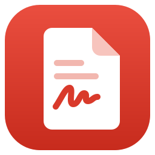
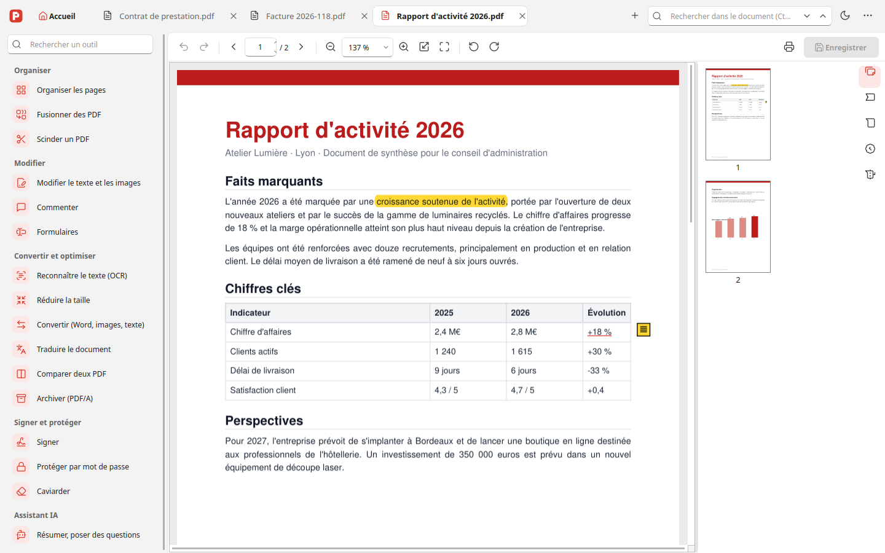
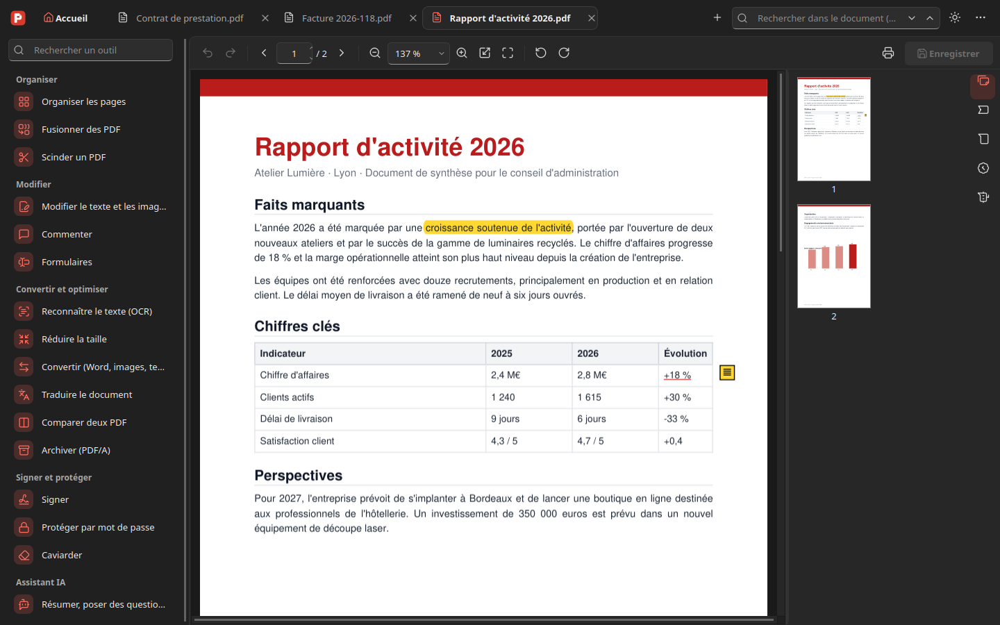
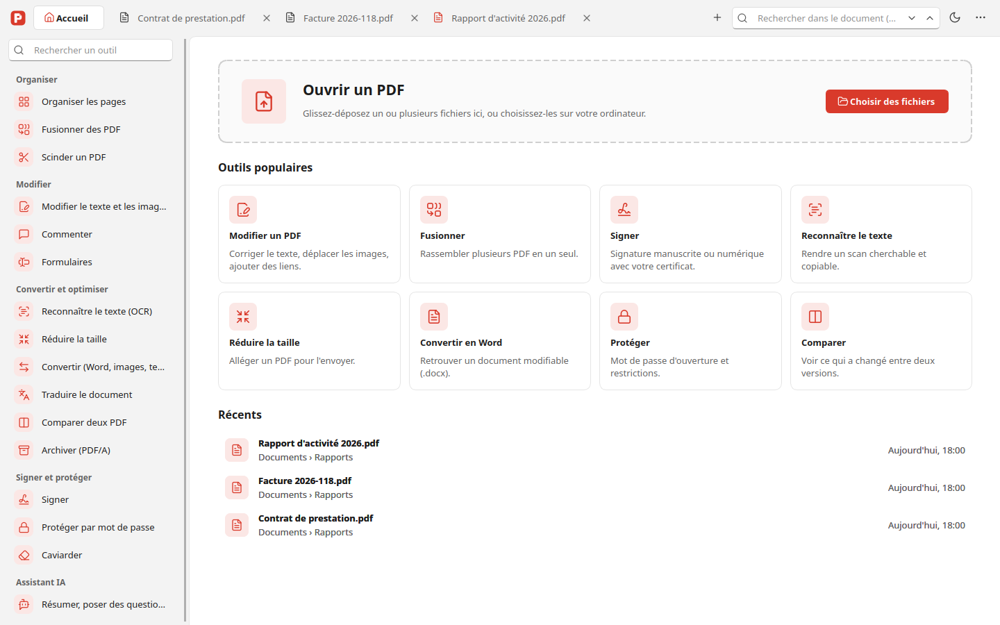
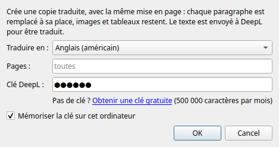

<div align="center">



# PDFManager

**A free, offline PDF editor for Windows.**<br>
Edit, annotate, sign, OCR, translate and compress PDFs: no account, no watermark, no subscription.

[](https://github.com/alexandreromanini/PDFManager/releases/latest)
[](https://github.com/alexandreromanini/PDFManager/actions/workflows/build-windows.yml)
[](#download)
[](docs/DEVELOPMENT.md)
[](LICENSE)

[**Download for Windows**](https://github.com/alexandreromanini/PDFManager/releases/latest) ·
[Features](#features) ·
[Screenshots](#screenshots) ·
[User guide](docs/GUIDE.md) ·
[Français](README.fr.md)



</div>

## Why PDFManager?

- **Everything a PDF editor should do, in one app**: the everyday features of Acrobat Pro
  (editing, comments, forms, signatures, OCR, conversions), free and open source.
- **Private by design**: your documents are processed on your computer. Nothing is uploaded,
  except the text you choose to translate with DeepL.
- **Modern Windows 11 look**, light and dark themes, tabs, drag and drop, keyboard shortcuts.
- **Safe editing**: every change can be undone, files are saved atomically, and damaged files
  are repaired on opening.

> The interface is in French. An English interface is not available yet.

## Features

| | |
|---|---|
| **View and organize** | Tabs, thumbnails, bookmarks, search, continuous or two-page view, presentation mode. Reorder, rotate, delete, extract, crop and insert pages; merge and split PDFs. |
| **Edit** | Edit existing text in place (keeps the original font when possible), add text, images and links, headers, footers, page numbers and watermarks. True redaction that really removes the content. |
| **Comment** | Highlight, underline, strike out, sticky notes, free text, shapes, freehand drawing and stamps. |
| **Forms** | Fill in forms, and create text fields, checkboxes, lists and signature fields. |
| **Sign and protect** | Handwritten signature, digital signatures (PAdES, with timestamp) and signature verification; AES-256 password protection and permissions. |
| **Convert and optimize** | OCR (French and English, built in), file size reduction, PDF to Word, images or text, images and Office documents to PDF, PDF/A archiving, side-by-side comparison of two PDFs. |
| **Translate** | Translate a whole document with DeepL while keeping its layout: each paragraph and table cell is rewritten in place. 28 languages. |
| **AI assistant** | Summarize a document and ask questions about it, with a small model that runs **offline** on your computer (optional 2.5 GB download). |

See the [user guide](docs/GUIDE.md) (French) for every feature and its known limits.

## Screenshots

<table>
  <tr>
    <td></td>
    <td></td>
  </tr>
  <tr>
    <td align="center">Dark theme</td>
    <td align="center">Home screen: popular tools and recent files</td>
  </tr>
</table>

<p align="center"><br>Translating a document with DeepL</p>

## Download

1. Download **`PDFManager-x.y.z-setup.exe`** from the
   [latest release](https://github.com/alexandreromanini/PDFManager/releases/latest).
2. Run it. Windows may show *“Windows protected your PC”* because the installer is not
   code-signed: click **More info**, then **Run anyway**.
3. PDFManager checks for new versions and updates itself in one click.

Requirements: Windows 10 or 11, 64-bit. Python is not needed: it is included in the installer.
Optional: [Ghostscript](https://ghostscript.com/releases/gsdnld.html) for PDF/A,
[LibreOffice](https://www.libreoffice.org/download/download-libreoffice/) to convert Office documents.

### Two editions

PDFManager exists in two editions with the same features and the same look:

| | PDFManager (this repository) | [PDFManager-rs](https://github.com/alexandreromanini/PDFManager-rs) |
|---|---|---|
| Written in | Python 3.12, PySide6 (Qt), PyMuPDF | Rust, Slint, MuPDF |
| Installer | ~100 MB | ~16 MB |
| Best for | Hacking on the code in Python | Everyday use: faster start, smaller |

## Privacy

PDFManager works offline. It only goes online to:

- check for updates on GitHub;
- translate, when you use **Translate the document** (the text is sent to DeepL);
- download the AI model, once, if you choose to enable the assistant.

## Build from source

```bash
python3.12 -m venv .venv
.venv/bin/pip install -e ".[dev,build]"
.venv/bin/python -m pdfmanager            # run
.venv/bin/python -m pytest -q             # tests (about 200, headless)
```

The Windows installer is built by GitHub Actions on every tag. See
[docs/DEVELOPMENT.md](docs/DEVELOPMENT.md) (French) for the build, the project structure and
technical notes.

## Contributing

Bug reports, ideas and pull requests are welcome, in English or French. Please read
[CONTRIBUTING.md](CONTRIBUTING.md) first. To report a security issue, see [SECURITY.md](SECURITY.md).

## License

PDFManager is free software, released under the [GNU AGPL v3.0 or later](LICENSE).

Built with [PyMuPDF](https://github.com/pymupdf/PyMuPDF) and [MuPDF](https://mupdf.com),
[Qt for Python](https://doc.qt.io/qtforpython-6/), [pyHanko](https://github.com/MatthiasValvekens/pyHanko),
[pikepdf](https://github.com/pikepdf/pikepdf), [pdf2docx](https://github.com/ArtifexSoftware/pdf2docx),
[Tesseract](https://github.com/tesseract-ocr/tesseract), [llama.cpp](https://github.com/ggml-org/llama.cpp)
and [Lucide](https://lucide.dev) icons.
